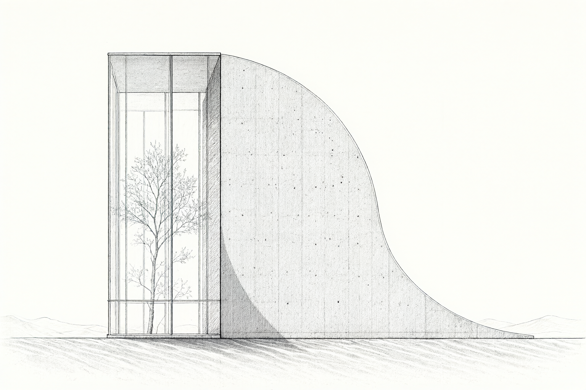
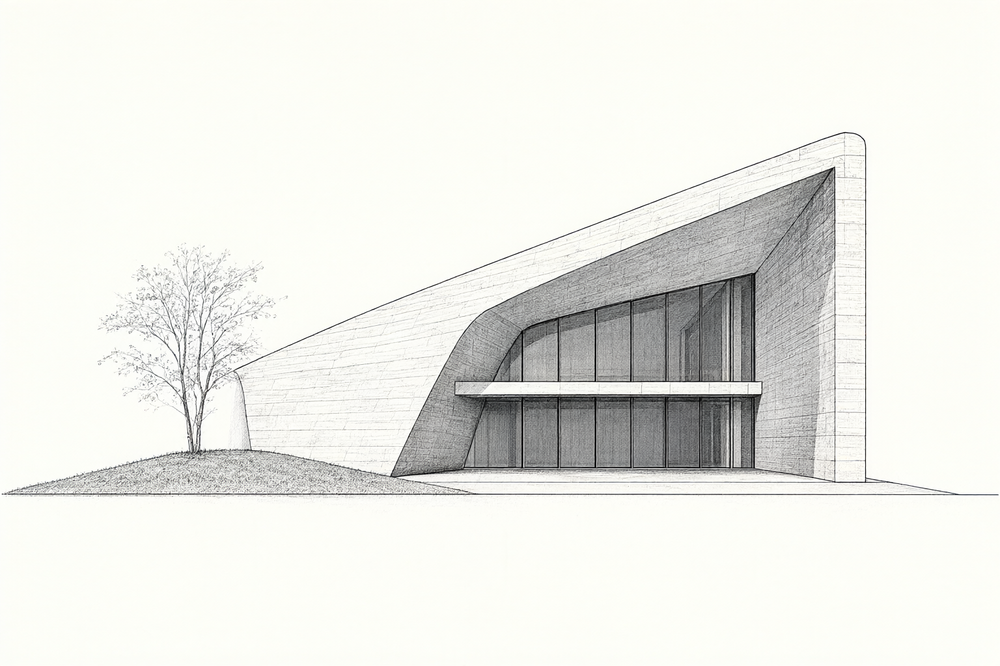

# Architektur in Tusche – Claude Skill

Aus einem Foto oder einer Idee wird eine Architekturzeichnung in Tusche, die sich im Browser **Linie für Linie** aufbaut: erst die Konturen, dann Tinte, Schatten und Korn.

| Wüstenpavillon | Faltenhaus |
| --- | --- |
|  |  |

## Was der Skill macht

1. **Fragt ab**, welches Gebäude und welches Ergebnis du willst (Bild, Animation oder beides). Per Auswahl wie `1a, 2c` oder Freitext.
2. **Zeichnet** das Gebäude als orthogonale Ansicht in schwarzer Tusche auf warmem Papier, mit deinem Bildgenerator.
3. **Baut eine Browseranimation**: SVG-Linien zeichnen die Kontur, eine Canvas-Maske lässt die Tusche organisch erscheinen. Mit Pause, Neustart, Zeitleiste, Loop und Reduced Motion.
4. **Prüft** das Ergebnis im Browser: Anfang, Mitte, Endbild, Handy-Ansicht.

## Installation

### Claude Code

```bash
git clone https://github.com/Mike-Hillebrand/architecture-ink-reveal.git
cp -R architecture-ink-reveal/architecture-ink-reveal ~/.claude/skills/
python3 -m pip install pillow numpy
```

Danach in Claude Code eintippen:

```
/architecture-ink-reveal
```

### Codex

Den Ordner `architecture-ink-reveal/` in dein Codex-Skills-Verzeichnis kopieren. `agents/openai.yaml` liefert Name und Startprompt.

## Voraussetzungen

- Python 3 mit **Pillow** und **NumPy** (für das Hilfsskript)
- Ein **Bildgenerator**, den dein Agent aufrufen kann (z. B. ein Bild-Skill oder ein lokales Modell wie Qwen Image). Der Skill erfindet keine Ersatzbilder per Code.
- Ein Browser zum Ansehen. Die Vorschau braucht einen lokalen HTTP-Server, `file://` reicht nicht.

## Schritt für Schritt

1. `/architecture-ink-reveal` starten und die Fragen beantworten. Foto anhängen, wenn es ein echtes Gebäude sein soll.
2. Der Agent legt einen Projektordner an mit `briefing.md` (alle Entscheidungen) und `drawing.prompt` (der verwendete Bildprompt).
3. Die Zeichnung wird erzeugt und geprüft.
4. Das Hilfsskript baut die Animation:

   ```bash
   python3 ~/.claude/skills/architecture-ink-reveal/scripts/build_preview.py \
     --image /pfad/zeichnung.png --output /pfad/vorschau \
     --title "Beton, Linie für Linie." --duration 12
   ```

5. Ansehen:

   ```bash
   python3 -m http.server 8766 --bind 127.0.0.1 --directory /pfad/vorschau
   ```

   Dann http://127.0.0.1:8766/ öffnen.

### Wichtige Optionen

| Option | Wirkung |
| --- | --- |
| `--mode both\|contours\|ink` | Konturen plus Tinte, nur Konturen oder nur Tinte |
| `--direction top-down\|bottom-up\|left-right\|center-out` | Richtung des Reveals |
| `--duration 12` | Dauer in Sekunden |
| `--loop` | Endlosschleife |
| `--ground-y 759` | Bodenlinie von Hand setzen, wenn sie nicht erkannt wird |
| `--vertical-min 30` | Mindestlänge senkrechter Linien (Standard: 3 % der Bildhöhe) |

## Als Video für Reels / TikTok

```bash
npm i playwright-core
node ~/.claude/skills/architecture-ink-reveal/scripts/capture_frames.js http://127.0.0.1:8766/ ./frames 30 12000
```

Das Skript nimmt die Animation Frame für Frame auf. Den Schnitt auf 9:16 mit ffmpeg (Texte, Musik, Lautheit) beschreibt [`references/video-export.md`](architecture-ink-reveal/references/video-export.md). Voraussetzung: Google Chrome und ffmpeg.

## Grenzen

- Die Linienerkennung findet waagrechte und senkrechte Kanten. Kurven, schräge Stützen und Bäume kommen über die Tusche-Ebene, nicht als Vektor.
- Eine Browseranimation ist kein Video. Für Reels/TikTok `capture_frames.js` und ffmpeg nutzen (siehe oben).
- Bildgeneratoren halten „streng orthogonal“ nicht immer ein. Das Ergebnis immer ansehen.

## Lizenz

MIT – siehe [LICENSE](LICENSE). Gebaut von [Mike Hillebrand](https://github.com/Mike-Hillebrand).
